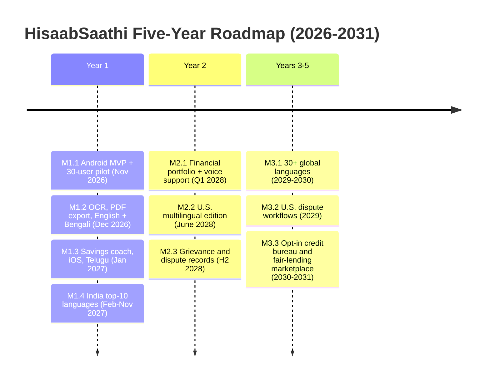
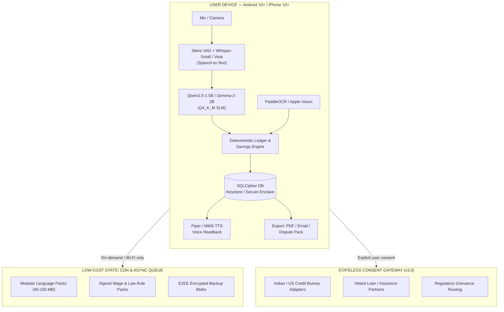
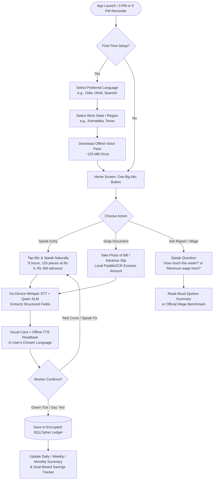
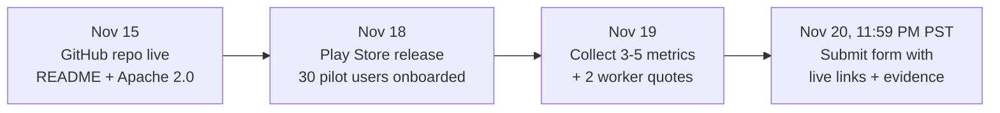

# HisaabSaathi — Full Proposal Rewrite (Phases 1–3)

**Applicant:** Acxelin Labs LLC
**Program:** Mozilla Foundation — Human-Scale AI Incubator, Call for Proposals
**Submission deadline:** November 20, 2026 (11:59 PM PST)
**Document date:** November 13, 2026

---

# Proposal Rewrite — Phase 1: Vision, Problem, Power Asymmetry & 5-Year Roadmap

## 1. Executive Summary

HisaabSaathi ("My Finance Companion") is a voice-first, offline-first, open-source mobile assistant built by Acxelin Labs LLC to empower daily-wage, piece-rate, and informal workers. Using quantized on-device Speech-to-Text (STT), Small Language Models (SLMs), and Text-to-Speech (TTS), workers speak naturally in their native languages (starting with Odia and Hindi) to log work hours, piece counts, wages, advances, and daily expenses—receiving spoken daily, weekly, monthly, and annual summaries without typing or internet connectivity.

Unlike extractive fintech apps that harvest user behavior to push predatory loans, HisaabSaathi keeps all financial ledgers encrypted locally on the user's phone. By giving informal workers an auditable, self-owned financial record and verified legal wage benchmarks, HisaabSaathi directly corrects the power asymmetry between unorganized laborers and employers.

## 2. The Community & Economic Problem

Across India—and among migrant and gig communities in the United States—hundreds of millions of adults aged 18+ earn their livelihoods in the informal economy (construction, garment manufacturing, packaging, domestic work, agriculture, and daily gig labor).

- **Economic Vulnerability & Irregular Cash Flows:** Informal workers rarely receive fixed monthly salaries or formal payslips. Their earnings fluctuate daily based on hours worked, piece-rate output (e.g., 120 pieces at ₹5/piece), deductions, and frequent mid-week cash advances (*kharchi*).
- **Literacy & Digital Barriers:** Standard accounting apps and spreadsheets assume high text literacy, comfort with complex forms, and reliable mobile data. Both non-educated workers and time-constrained educated workers abandon manual ledger apps within days.
- **Interstate & Cross-Border Language Gaps:** Millions of workers migrate across linguistic regions—such as Odia speakers working in Bengaluru (Karnataka) or Hyderabad (Telangana), or Spanish, French, and Chinese-speaking workers navigating financial systems in the U.S. When workers cannot read local wage notices or contracts, they are routinely underpaid or misinformed.
- **Lack of Proof for Credit, Disputes, and Savings:** Because informal workers have no structured record of their income and expenses, they are excluded from formal banking, cannot verify wage theft during disputes, and struggle to plan savings around irregular cash inflows.

## 3. Addressing Power Asymmetry Through Sovereign, Non-Extractive AI

Informal labor markets suffer from information asymmetry: contractors, middlemen, and employers hold the ledger, calculate deductions unilaterally, and control dispute narratives, while workers rely on memory or easily lost paper scraps.

HisaabSaathi shifts this balance of power through four architectural commitments:

1. **Worker-Sovereign Ledgers:** Every work log, advance, receipt photo, and wage calculation belongs exclusively to the worker. Employers and third parties have zero background visibility into the ledger.
2. **Non-Extractive, On-Device Intelligence:** Core voice transcription, entity extraction, and financial summaries execute 100% locally on the worker's smartphone. Raw voice recordings and personal ledgers are never uploaded to train commercial AI models or sold to data brokers.
3. **Verifiable Evidence for Dispute Settlement:** By combining timestamped voice-confirmed entries with photos of bills, advance slips, and official government minimum-wage notifications, workers possess tamper-evident documentation they can export on demand for trade unions, labor commissioners, legal-aid clinics, or consumer dispute forums.
4. **Opt-In Granular Sharing:** When future marketplace or credit-check features are introduced, the worker acts as the sole data fiduciary—choosing to share only a cryptographic or summarized proof of income rather than surrendering raw transaction histories.

## 4. Five-Year Product & Community Roadmap (2026–2031)

### Year 1 (Nov 2026 – Nov 2027): Core Offline Voice Ledger & Indian Vernacular Foundation

- **Milestone 1.1 — Android MVP & Pilot Launch (Nov 15 – Nov 20, 2026):** Release open-source codebase on GitHub and publish Android app on Google Play Store supporting Hindi and Odia. Core capabilities include on-device STT + SLM voice logging of income, piece-rate work, advances, and expenses; smart local reminders twice daily (3:00 PM and 9:00 PM local time); and spoken TTS daily, weekly, monthly, and annual reports. Onboard 30+ active pilot users by Nov 18–20, 2026.
- **Milestone 1.2 — Document Capture, Email Export & Language Expansion (Dec 18, 2026):** Add local OCR/image attachment for cash advance slips, loan receipts, invoices, bills, employer/company names, and bank statements. Enable user-triggered email/PDF export of periodic reports. Add English and Bengali language support.
- **Milestone 1.3 — Goal-Based Savings Coach & iOS Launch (Jan 31, 2027):** Launch on-device goal-based savings recommendations tailored to irregular income/expense patterns. Release the iOS application (iPhone 10 / iOS 13+ compatible) and add Telugu language support.
- **Milestone 1.4 — India Top-10 Languages & Continuous Model Tuning (Feb – Nov 2027):** Add one new language per month alongside continuous noisy-environment STT/TTS fine-tuning, reaching full coverage of India's top 10 languages across Android and iOS by November 2027.

### Year 2 (Dec 2027 – Nov 2028): Pan-India Scale, Financial Protection & U.S. Expansion

- **Milestone 2.1 — Holistic Financial Portfolio & Multilingual Voice Support (Q1 2028):** Allow workers to locally organize investment plans, micro-insurance policies, and active loans. Introduce an opt-in voice feedback channel where users speak in any language to report issues, processed by multilingual AI support agents.
- **Milestone 2.2 — U.S. Multilingual Edition Planning & Launch (Dec 2027 – June 2028):** Adapt the offline-first ledger and local wage/labor-rule lookup for U.S. gig, domestic, agricultural, and service workers, launching in June 2028 with support for English, Spanish, French, and Mandarin Chinese.
- **Milestone 2.3 — Structured Financial Grievance & Dispute Records (H2 2028):** Launch guided dispute-documentation workflows in India that format worker records and complaints for submission to employers, banks, NBFCs, or labor/banking ombudsmen in compliance with Indian law.

### Years 3–5 (2029 – 2031): Global Language Equity, Legal Dispute Resolution & Worker-Controlled Financial Access

- **Milestone 3.1 — 30+ Global & Regional Languages (Ongoing 2029–2030):** Expand on-device ASR/TTS packs at a cadence of one language per month across South Asian, Southeast Asian, and immigrant languages, driven by installation telemetry and community contributors.
- **Milestone 3.2 — U.S. Financial & Labor Dispute Workflows (2029):** Extend structured grievance logging and compliant record formatting to U.S. federal and state consumer/labor dispute standards.
- **Milestone 3.3 — Opt-In Credit Bureau & Fair-Lending Marketplace (2030–2031):** Integrate regulated credit-score checks (via authorized Indian and U.S. credit bureaus as permitted by law) and an opt-in partner marketplace for fair micro-loans and insurance—allowing workers to prove creditworthiness from their own ledger without surrendering data ownership.

### Roadmap at a glance



---

# Proposal Rewrite — Phase 2: Technical Architecture, Models & UX/UI

## 5. Multi-Year Technical Solution Architecture (v1.0 – v3.0)

To serve millions of 18+ users across India (both non-educated daily-wage workers and educated salaried/gig workers) and expand to U.S. multilingual communities (English, Spanish, French, Mandarin Chinese) without unsustainable cloud bills, HisaabSaathi uses an **Edge-First, Zero-Inference-Cloud Architecture**. Because speech recognition, intent extraction, OCR, and TTS run locally on the user's phone, marginal AI compute cost per user is **$0.00**.

### Architecture v1.0 (Nov 2026 – Jan 2027): Pure On-Device Edge Core

- **Target Scale & Users:** 30 to 50,000+ users in India (Odia, Hindi, English, Bengali, Telugu) on entry-level Android (3GB–4GB RAM, Android 10+) and iPhone 10 / X (A11 Bionic, 3GB RAM, iOS 16+).
- **Execution Pipeline (100% Offline):**
  1. **Audio Capture & VAD:** Silero VAD (Voice Activity Detection, <2 MB) trims silence and filters construction/factory background noise.
  2. **On-Device STT:** Quantized Whisper-Small (or Vosk lightweight acoustic models for ultra-low-end <3GB devices) converts vernacular speech to text via whisper.cpp / ONNX Runtime.
  3. **On-Device SLM Extraction:** A 4-bit quantized Small Language Model (Qwen2.5-1.5B-Instruct or Gemma-2-2B-IT via llama.cpp / Google LiteRT) converts unstructured speech into strict JSON (`type`, `hours`, `pieces`, `rate`, `advance`, `expense_category`, `amount`).
  4. **Confirmation & TTS:** Deterministic SQLite ledger engine computes totals and triggers native/bundled offline TTS (MMS-TTS / Piper TTS for Odia/Hindi/Bengali/Telugu) to read back the entry for one-tap confirmation.
  5. **Local Encrypted Storage:** SQLCipher (AES-256) database with encryption keys protected by Android Keystore (TEE/StrongBox) and iOS Secure Enclave.
- **Cloud Footprint (v1.0):** Near-zero. Static CDN (Cloudflare R2 / GitHub Releases) hosts downloadable modular language packs (40–150 MB per language) so the base APK stays under 45 MB.

### Architecture v2.0 (Feb 2027 – June 2028): Modular Language Packs, Local OCR & U.S. Expansion

- **Target Scale & Users:** 50,000 to 2M+ users across India's top 10 languages + U.S. launch (English, Spanish, French, Mandarin Chinese).
- **Architectural Updates Required for U.S. & Multilingual Scale:**
  - **Does U.S. Expansion Require a Core Architecture Rewrite? No.** The core edge runtime (whisper.cpp + llama.cpp + SQLCipher) remains identical. Instead, HisaabSaathi separates **Language Packs** from **Jurisdiction Rule Packs** (see diagram below).
  - **Dynamic Model Routing:** On older devices (iPhone 10/11 or 3GB Androids), the app loads 1.5B–2B quantized models (Q4_K_M). On newer devices (iPhone 13+ or 6GB+ Androids), it optionally upgrades to 3B models (Qwen2.5-3B or Phi-3.5-mini) for richer savings coaching and multi-turn Q&A.
  - **On-Device Document OCR (Dec 2026+):** PaddleOCR (mobile v4) / ML Kit / Apple Vision extracts amounts, dates, vendor/company names, and invoice numbers from photos of cash advance slips, bills, and bank statements completely offline.
  - **Encrypted Sovereign Backup & Async Sync:** Optional end-to-end encrypted (E2EE) delta sync using user-held passkeys (client-side encrypted blobs stored on user's personal Google Drive/iCloud or low-cost object storage), solving lost/shared phone recovery without server-side decryption capability.
  - **Async Voice Support Queue:** When users opt in to submit voice feedback in any language, compressed Opus audio (~16 kbps) uploads asynchronously when Wi-Fi/data is available to a serverless queue for batch transcription and support triage.

### Architecture v3.0 (2029 – 2031): Federated Rules Engine, Grievance Vault & Zero-Knowledge Partner Gateway

- **Target Scale & Users:** 5M–20M+ users across India and the U.S., covering 30+ languages, credit bureau checks, grievance filing, and opt-in financial marketplaces.
- **Architectural Updates:**
  - **Jurisdiction & Compliance Rule Packs (Signed JSON/SQLite):** Versioned, cryptographically signed rule bundles covering Indian state minimum wages, Indian consumer/labor complaint formats, and U.S. federal/state labor and consumer protection templates.
  - **Tamper-Evident Grievance Vault:** Generates SHA-256 hash chains and signed PDF/JSON evidence bundles locally on the device for legal/regulatory disputes in India and the U.S.
  - **Zero-Knowledge / Consent-Gated API Gateway:** A stateless microservice gateway that connects to regulated Indian/U.S. credit bureaus and vetted loan/insurance partners. No raw ledger data transits this gateway; only explicit, user-authorized tokens and summary proofs are transmitted per session.

### System architecture (original ASCII diagram)

```text
+-----------------------------------------------------------------------------------+
|                        USER DEVICE (Android 10+ / iPhone 10+)                     |
|                                                                                   |
|  [Mic / Camera] ---> [Silero VAD + Whisper-Small / Vosk (STT)]                    |
|                           |                                                       |
|                           v                                                       |
|                      [Qwen2.5-1.5B / Gemma-2-2B (Q4_K_M SLM)]                     |
|                           |                                                       |
|  [PaddleOCR / Vision] --->+---> [Deterministic Ledger & Savings Engine]           |
|                                      |                                            |
|                                      v                                            |
|                   [SQLCipher DB (Keystore / Secure Enclave)]                      |
|                      |                                   |                        |
|                      v                                   v                        |
|        [Piper / MMS-TTS Voice Readback]    [Export: PDF / Email / Dispute Pack]   |
+----------------------|-----------------------------------|------------------------+
                       | (On-Demand / Wi-Fi Only)          | (Explicit User Consent)
                       v                                   v
+---------------------------------------+   +---------------------------------------+
|   LOW-COST STATIC CDN & ASYNC QUEUE   |   |   STATELESS CONSENT GATEWAY (v3.0)    |
| - Modular Language Packs (40-150MB)   |   | - Indian/US Credit Bureau Adapters    |
| - Signed Wage & Law Rule Packs        |   | - Vetted Loan/Insurance Partners      |
| - E2EE Encrypted Backup Blobs         |   | - Regulatory Grievance Routing        |
+---------------------------------------+   +---------------------------------------+
```

### System architecture (mermaid version of the same diagram)



## 6. Exact Model Selection & Hardware Justification

Mozilla specifically asks why chosen models fit target hardware. Every model in HisaabSaathi is selected to run within **< 1.4 GB peak RAM**, ensuring smooth execution on budget Indian smartphones (3GB–4GB RAM, MediaTek Helio G-series / Snapdragon 4-series) and legacy iOS devices (iPhone 10 / A11 Bionic, 3GB RAM).

| Pipeline Stage | Selected Open Models | Quantization / Footprint | Hardware Fit & Why It Works on Target Devices |
|---|---|---|---|
| Voice Activity Detection | Silero VAD v5 | FP32 / ONNX (~2 MB) | Strips ambient construction, traffic, and factory noise in <10 ms per frame, preventing false triggers and saving battery. |
| Speech-to-Text (Primary) | OpenAI Whisper-Small (fine-tuned on Common Voice + Indian/US accents) via whisper.cpp | Q5_1 (~190 MB disk, ~420 MB RAM) | Strong multilingual accuracy across Odia, Hindi, Bengali, Telugu, English, Spanish, French, and Mandarin; runs at ~0.4x real-time on A11 Bionic and mid-range ARM Cortex-A55/A75 CPUs. |
| Speech-to-Text (Ultra-Low RAM Fallback) | Vosk / Kaldi compact acoustic models + IndicWhisper-Tiny | INT8 (~45–75 MB disk, ~150 MB RAM) | Automatic fallback for 2GB–3GB RAM Android devices where Whisper-Small causes memory pressure. |
| Intent & Entity Extraction (SLM) | Qwen2.5-1.5B-Instruct (primary) or Gemma-2-2B-IT via llama.cpp / Google LiteRT | Q4_K_M (~950 MB disk, ~1.1 GB peak RAM) | Strong structured JSON output and multilingual numeracy (handling mixed Indian/English numbers like "120 piece, paanch rupaya rate, 300 advance"). Fits safely inside iPhone 10's 3GB RAM limit alongside iOS overhead. |
| Text-to-Speech (TTS) | Meta MMS-TTS (for Odia, Hindi, Bengali, Telugu) + Piper TTS (for English, Spanish, French, Mandarin) | VITS INT8 (~25–45 MB per language) | Ultra-fast (>15x real-time on CPU), natural local pronunciation for reading back entries and financial reports to non-literate users. |
| Document OCR (v1.2+) | PaddleOCR v4 Mobile (Android) & Apple Vision (iOS) | INT8 (~12 MB) | Extracts totals, dates, and merchant/company names from crumpled advance slips and bills locally without uploading sensitive financial documents. |

### How Cloud Costs Stay Near Zero at Scale

- **Zero Per-Query Inference Cost:** All STT, SLM, OCR, and TTS compute runs on user hardware. Whether HisaabSaathi has 30 users or 10 million users, GPU server inference cost is $0.
- **On-Demand Language Pack Downloads:** Users only download the 1–2 languages they speak from a low-cost CDN, keeping bandwidth and storage costs negligible (<$0.002 per user).
- **Scheduled Local Notifications:** The 3:00 PM and 9:00 PM reminders are triggered natively via Android WorkManager and iOS UNUserNotificationCenter without requiring paid push-notification servers.

## 7. User Experience (UX) & UI Design Diagrams

### A. End-to-End User Experience Flow (Voice-First & Non-Educated Friendly)



### B. Mobile UI Screen Architecture (4-Screen Simplicity)

```mermaid
graph LR
    subgraph S1 ["1. Home Screen: Zero Clutter"]
        direction TB
        S1_Top["Top Bar: Language Pill 'ଓଡ଼ିଆ' | Work State 'Karnataka'"]
        S1_Card["Today's Summary Card<br/>Earned: ₹600 | Advance: ₹300 | Due: ₹300"]
        S1_Mic(("LARGE GREEN MIC BUTTON<br/>'Tap & Speak Work or Expense'"))
        S1_Cam["Secondary Button: 'Scan Bill / Advance Slip'"]
        S1_Nav["Bottom Tabs: Home | Ledger | Summary | Wage & Help"]
    end

    subgraph S2 ["2. Voice Confirmation Screen"]
        direction TB
        S2_Wave["Audio Waveform + Spoken Transcript"]
        S2_Fields["Extracted Fields Card<br/>• Work: 120 pieces @ ₹5 = ₹600<br/>• Advance Taken: ₹300<br/>• Net Balance: ₹300"]
        S2_TTS["Speaker Icon: Re-play Readback"]
        S2_Act["BIG GREEN TICK: Save | BIG RED X: Fix by Voice"]
    end

    subgraph S3 ["3. Reports & Savings Goal Screen"]
        direction TB
        S3_Toggle["Toggle: Daily | Weekly | Monthly | Annual"]
        S3_Metrics["Income vs Expense Bar + Net Due"]
        S3_Goal["Savings Goal Tracker<br/>e.g., Home Remittance / Emergency Fund"]
        S3_Exp["Buttons: Read Report Aloud | Export PDF / Email"]
    end

    subgraph S4 ["4. Know My Wages & Dispute Vault"]
        direction TB
        S4_Wage["Official Minimum Wage Benchmark<br/>with Gazette Notification Date & Source"]
        S4_Comp["Your Recorded Avg vs Official Benchmark"]
        S4_Disp["Log Complaint / Export Evidence Pack<br/>for Union, Bank, or Labor Office"]
    end

    S1 -- "Speak / Scan" --> S2
    S2 -- "Confirm" --> S1
    S1 -- "Tap Summary" --> S3
    S1 -- "Tap Wage & Help" --> S4
```



---

# Proposal Rewrite — Phase 3: Community Fit, Open Source, Sustainability & Team

## 8. Product-Community Fit & Live Pilot Validation (Nov 15 – Nov 20, 2026)

Mozilla's Call for Proposals prioritizes working technology with early, verifiable signals of product-community fit. Rather than submitting a theoretical concept, Acxelin Labs LLC is launching a live, open-source MVP before the November 20, 2026 deadline:

- **Open-Source Repository (Live Nov 15, 2026):** Full source code for the Android application, on-device speech-to-JSON extraction pipeline, SQLCipher encrypted storage layer, and localized Odia/Hindi voice prompts will be published publicly on GitHub under an open-source license (Apache 2.0 / MIT).
- **Public Play Store Release & 30-User Pilot (Nov 18 – Nov 20, 2026):** The Android app is published on the Google Play Store with an initial cohort of 30+ daily-wage and informal workers onboarded across Odisha and Hyderabad (Telangana).
- **Active Co-Design & Field Feedback Loop:**
  - Workers test twice-daily voice reminders (3:00 PM and 9:00 PM), log real piece-rate/daily work and cash advances in Odia and Hindi, and listen to spoken daily/weekly summaries.
  - Direct field observations—covering dialect variations, worksite background noise, button size legibility, and terminology around advances (*kharchi*)—directly inform the December 18, 2026 (v1.2) release.
- **Quantitative & Qualitative Evidence Included in Final Submission:** By November 20, our submission will include live Play Store links, GitHub commit history, aggregate anonymized pilot telemetry (total entries logged, voice confirmation vs. correction rates, latency on 3GB–4GB RAM devices), and direct worker testimonials.

## 9. Working in the Open: Public Building Blocks Left Behind

In alignment with Mozilla Foundation's commitment to open-source ecosystems and shared public infrastructure, HisaabSaathi will leave behind four reusable open-source assets for the broader Human-Scale AI community:

1. **HisaabSaathi Mobile Core (Apache 2.0):** Cross-platform offline-first voice ledger framework integrating whisper.cpp, llama.cpp / LiteRT, Piper/MMS-TTS, and hardware-backed SQLCipher encryption—ready for other builders to fork for rural health, agriculture, or community bookkeeping.
2. **Fine-Tuned Vernacular Numerical & Labor LoRA Adapters:** Open-weight speech and extraction adapters tuned for code-mixed Indian languages (Odia, Hindi, Bengali, Telugu, etc.) and U.S. immigrant languages (Spanish, French, Mandarin) handling noisy environments and financial numeracy.
3. **Structured Indian & U.S. Wage/Labor Benchmark Dataset:** A versioned, open-access JSON/SQLite repository mapping official Indian state minimum wage notifications (by state, industry, skill tier, and gazette citation) and U.S. federal/state wage floors.
4. **Low-Literacy Voice UX Playbook:** Open documentation and usability findings detailing how to design zero-form, voice-confirmed financial interfaces for first-time smartphone users.

## 10. Long-Term Sustainability Model (Beyond the Incubator)

HisaabSaathi's core offline ledger, voice logging, and wage-benchmark features will remain 100% free, ad-free, and non-extractive for individual workers forever. To sustain ongoing language expansion, security audits, and dispute-resolution infrastructure beyond the 1–3 year Mozilla Incubator period without monetizing worker data, Acxelin Labs LLC will pursue a diversified, mission-aligned sustainability model:

- **Institutional & CSR Grants (India & Global):** Partnering with Indian corporate CSR programs (mandated under India's Companies Act Section 135), philanthropic foundations, and digital public infrastructure initiatives focused on financial inclusion and migrant worker welfare.
- **Trade Union, NGO & Worker Cooperative Licensing:** Offering custom-branded or white-label community deployments (with aggregate, opt-in, anonymized labor-trend dashboards) funded by labor welfare boards, trade unions, and legal-aid NGOs—while keeping individual worker ledgers strictly private on-device.
- **Opt-In, User-Controlled Financial Access (Years 3–5):** Once workers build verified income histories on their own phones, they can optionally choose to share a zero-knowledge or summary creditworthiness proof with regulated banks, micro-lenders, or micro-insurers. Any referral or API integration fee paid by vetted financial institutions is transparent to the user and requires explicit, per-transaction consent, ensuring the worker—not a broker—controls their financial identity.

## 11. Team Qualifications, Community Ties & Legal Eligibility

### Leadership & Engineering Team

- **Mansoor Khan — Chief Executive Officer (Fremont, California, USA):** Technology executive and entrepreneur leading product vision, cross-border strategy, regulatory compliance, and partnerships across the United States and India.
- **Priya Ranjan Kumar — VP of Research & Innovation (Frisco, Texas, USA):** AI researcher and systems architect overseeing on-device quantized SLM/STT optimization, privacy-preserving edge inference, and multi-year technical scalability (v1.0–v3.0).
- **Aditya Panda — Software Engineer (Odisha, India):** Native Odia speaker and mobile engineer leading vernacular voice UX, Odia/Hindi speech pipeline integration, and on-ground pilot testing with Odia workers.
- **Lakshmi Monish — Software Engineer (India):** Full-stack and mobile engineer building the offline SQLCipher storage engine, document OCR pipeline, and cross-platform Android/iOS architecture.
- **Kalyan Kartik — Customer Success & Community Lead (India):** Leads worker onboarding, field usability testing, NGO/union coordination, and multilingual user feedback loops.
- **Core Engineering Team (15 Software Engineers, Hyderabad, India):** A dedicated 15-engineer product, AI/ML, QA, and mobile engineering team based in Hyderabad, providing full-capacity execution to deliver rapid monthly language rollouts, iOS/Android parity, and rigorous security testing.

### Deep Grassroots & Cross-Cultural Community Ties

Our team combines Silicon Valley/Texas AI systems engineering with direct, lived roots in Indian and U.S. working-class communities. With team members based across Odisha, Hyderabad (Telangana), California, and Texas, we maintain active, inclusive relationships across diverse linguistic and religious communities—spanning Hindu, Muslim, Christian, and Sikh worker networks in both India and the United States. This trust-based community access enables authentic co-design with migrant construction workers, garment workers, and gig laborers rather than top-down assumptions.

### Legal Eligibility & Charitable Purpose Statement

- **Legal Entity:** Acxelin Labs LLC is a registered U.S. Limited Liability Company in good standing, legally eligible to receive grant funding from a U.S.-based 501(c)(3) public charity such as the Mozilla Foundation.
- **Strict Charitable Ring-Fencing:** While Acxelin Labs LLC is a for-profit entity, all Mozilla Foundation Incubator grant funds will be restricted exclusively to charitable, public-benefit deliverables: building and maintaining the free, open-source HisaabSaathi core application, publishing open-weight vernacular speech models, maintaining open legal wage datasets, and serving underserved daily-wage and informal workers in India and the United States with zero data extraction or commercial lock-in.

## Pre-Submission Checklist (Nov 13 – Nov 20, 2026)

To ensure your application clears every Mozilla screening filter on November 20, 2026:

1. **Nov 15:** Push clean code + README + Apache 2.0 license to your public GitHub repo.
2. **Nov 18:** Publish the Android APK on Google Play Store and onboard your 30 pilot users in Odisha/Hyderabad.
3. **Nov 19:** Collect 3–5 real metrics (e.g., total logs recorded, average voice-to-record time, Odia/Hindi word recognition accuracy) and 2 direct worker quotes from your pilot.
4. **Nov 20 (before 11:59 PM PST):** Submit the English application form with live links to your GitHub repository, Google Play Store listing, and pilot evidence.


