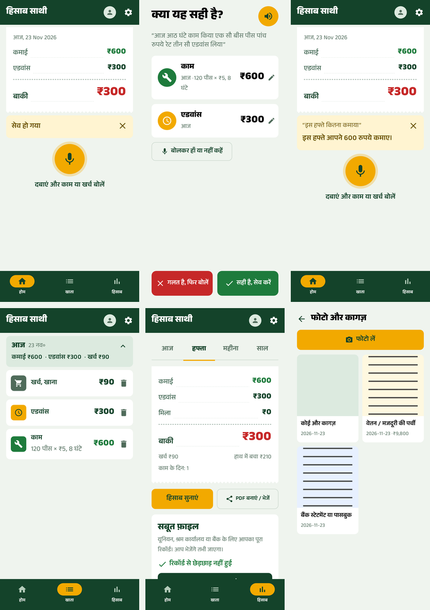

  

  

  

A worker taps one button and says what happened, for example *"Today I worked 8 hours,
120 pieces at 5 rupees each, took 300 rupees advance"*. HisaabSaathi writes it down, reads it
back, and saves it once they confirm. Later they ask *"How much did I earn this week?"* or *"How
much does the contractor still owe me?"* and hear the answer. They don't need to read or type.

It works entirely on the phone, with no internet after a one-time download. Nothing leaves the
phone unless the worker chooses: by sharing a report, or by saying yes to help improve the app.

  

It needs Android 10 or newer. Setup is three screens: language, name and PIN code. Each
question is asked aloud and answered by voice, or typed. The PIN fills in the state and
district, offline.

## What it does

- **Record by voice:**
  - work: hours, pieces and rate;
  - advances, wages received, and spending by category (food, travel, rent, phone, health,
    sent home);
  - if something is missing (the rate per piece, the amount), the app asks for it and listens;
  - a confirmation card read aloud; the app then listens for "yes" or "no", so the worker never
    has to touch the screen. Nothing is saved before a yes;
  - a short sound when the app starts listening, and another when it has heard.
- **Ask by voice:** what was earned, taken as advance, spent, or is still owed, for today,
  yesterday, this or last week, this or last month, or this year. Also the government minimum
  wage for their state. Local words and mixed English work: *dihadi, peshgi, hajira, dadan,
  mestri, "is week ka total"*.
- **Ledger by day:** daily totals; tap to change a line; undo a delete.
- **Summaries and a savings goal**, on screen and read aloud.
- **Minimum wage, by voice:** ask *"What is the minimum wage?"* and hear your state's official
  daily rate. Ten states so far, each figure with its government notice
  ([open dataset](data/minimum-wages/README.md)).
- **Photos of papers:** bills, advance slips, loan papers and salary slips become a line to
  confirm, with the amount read on the phone. Bank statements and other papers are kept as they
  are. All of them are in one place in the ledger.
- **Proof:**
  - a **PDF report** to share or print;
  - an **evidence pack**: every record and photo, with a check showing nothing was changed
    afterwards, for a contractor, labour office, union or NGO when wages are disputed.
- **Reminders** at 3 PM and 9 PM: tapping one opens the app already listening. Also **backup
  and restore**.

  

## Private by design

- Records are **encrypted on the phone** (SQLCipher, key held by the Android Keystore) and
  never go to a server or a cloud backup.
- Speech recognition, understanding and the reply voices all run **on the phone**.
- There are no accounts, no ads and no tracking. Only the worker sees their records.
- **Nothing is uploaded unless the worker agrees.** The app sends nothing by itself except what
  the worker said yes to below.
- **Help improve HisaabSaathi** is asked once, on Home, after the worker has used the app for a
  few days, never during setup. It can be read aloud, and nothing is chosen for the worker. Only if they say yes, two things are sent to the team over Wi-Fi:
  - each time they speak or type to the app, their voice clip, what the app heard, and what it
    understood and answered;
  - once a week, counts: how many entries were saved and how often the app got one wrong.
    These are numbers only.
- **What protects what they share:**
  - nothing carries their name or phone number, and anything containing a phone, Aadhaar or bank
    number is never kept;
  - each upload is encrypted on the phone, so only the team's training pipeline can open it;
  - it stays in the team's Azure account in India, from upload to training;
  - they can turn it off in Settings, which deletes what is still waiting, or have everything
    already sent deleted;
  - if the question changes what is sent, they are asked again.

  The upload service and pipeline are in [`server/`](server/README.md).

## How it understands

1. **Speech to text, on the phone:** AI4Bharat IndicConformer for the five Indian languages
   and NVIDIA Parakeet for English, run with sherpa-onnx.
2. **Rules first:** a grammar for numbers and ledger words in all six languages, including
   numbers said in English inside Indian sentences and common mishearings. All arithmetic is
   plain code.
3. **A small on-device language model**, Qwen3-0.6B fine-tuned for this app, runs only when
   the rules are unsure. It labels the numbers that were said, or names the period of a
   question. It never invents an amount: an answer that doesn't match the spoken numbers is
   discarded.
4. **Replies are spoken** with Indic Tiny TTS voices. English has an optional Indian English
   voice (about 91 MB, one tap in Settings); without it, the phone's own voice is used.

## For partners and builders

- **Unions, NGOs and labour offices:** a simple monthly log of wage disputes where HisaabSaathi
  records were used, with no names: [`docs/partners/dispute-log.md`](docs/partners/dispute-log.md).
- **Monthly updates:** what changed, how the app is used, and what we learned:
  [`docs/updates/`](docs/updates/README.md).
- **Designing for people who read little:** what building this taught us:
  [`docs/design/low-literacy-guide.md`](docs/design/low-literacy-guide.md).
- **Minimum wages:** [`data/minimum-wages/`](data/minimum-wages/README.md).

## Credits and licences

| Part | By | Licence |
|---|---|---|
| IndicConformer speech models | AI4Bharat | MIT |
| Parakeet TDT-CTC 110M | NVIDIA | CC-BY-4.0 |
| Qwen3-0.6B (base of the fine-tuned model) | Alibaba Cloud Qwen team | Apache-2.0 |
| Indic Tiny TTS voices | Sulabh Katiyar, on AI4Bharat Rasa | CC-BY-4.0 |
| Indic Tiny TTS Indian English voice | Sulabh Katiyar, on IISc's LIMMITS 2024 / SYSPIN corpus | CC-BY-4.0 |
| Vocos vocoder | Charactr | MIT |
| Silero VAD | Silero | MIT |
| sherpa-onnx | k2-fsa | Apache-2.0 |
| LiteRT-LM | Google | Apache-2.0 |
| ML Kit text recognition | Google | ML Kit terms |
| Anek fonts | Ek Type | OFL |
| PIN code directory | India Post (data.gov.in) | Government Open Data Licence – India |

The app's code is released under the [Apache License 2.0](LICENSE). The models and data above
keep their own licences. The minimum-wage dataset is CC-BY-4.0.

The fine-tuned model and the English speech model are published at
[huggingface.co/AcxelinLabs/hisaabsaathi-model](https://huggingface.co/AcxelinLabs/hisaabsaathi-model).

<b>HisaabSaathi</b> is built by <b>Acxelin Labs</b>.

