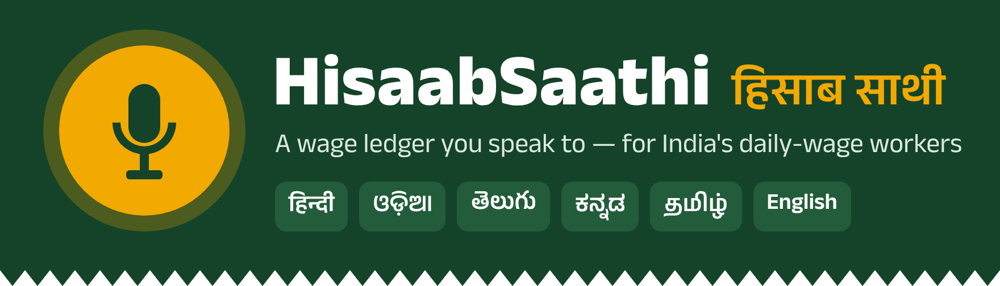
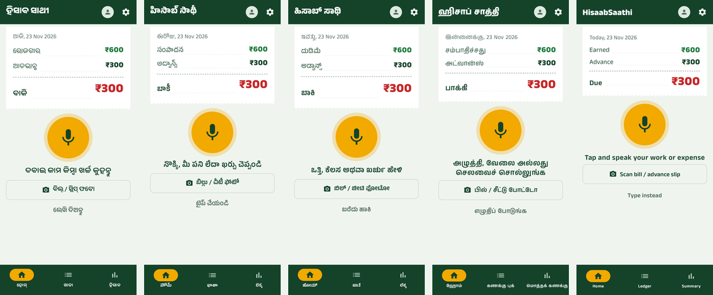

<p align="center">
  
</p>

<p align="center">
  <a href="https://huggingface.co/AcxelinLabs/hisaabsaathi-model/resolve/main/HisaabSaathi.apk"></a>
</p>

<p align="center">
  
</p>

A worker taps one button and says what happened, for example *"Today I worked 8 hours,
120 pieces at 5 rupees each, took 300 rupees advance"*. HisaabSaathi writes it down, reads it
back, and saves it once they confirm. Later they ask *"How much did I earn this week?"* or *"How
much does the contractor still owe me?"* and hear the answer. They don't need to read or type.

It works entirely on the phone, with no internet after a one-time download.

<p align="center">
  
</p>

It needs Android 10 or newer.

## What it does

- **Record by voice:**
  - work: hours, pieces and rate;
  - advances, wages received, and spending by category (food, travel, rent, phone, health,
    sent home);
  - a confirmation card read aloud, saved only when the worker says it's right.
- **Ask by voice:** what was earned, taken as advance, spent, or is still owed, for today,
  yesterday, this or last week, this or last month, or this year. Also the government minimum
  wage for their state. Local words and mixed English work: *dihadi, peshgi, hajira, dadan,
  mestri, "is week ka total"*.
- **Ledger by day:** daily totals; tap to change a line; undo a delete.
- **Summaries and a savings goal**, on screen and read aloud.
- **Minimum-wage check** against the official rates of the worker's state.
- **Proof:**
  - a **PDF report** to share or print;
  - an **evidence pack**: every record with a check showing nothing was changed afterwards,
    for a contractor, labour office, union or NGO when wages are disputed.
- **Bill or advance-slip photo** to amount, read on the phone.
- **Reminders** at 3 PM and 9 PM, and **backup and restore**.

<p align="center">
  
</p>

## Private by design

- Records are **encrypted on the phone** (SQLCipher, key held by the Android Keystore) and
  never go to a server or a cloud backup.
- Speech recognition, understanding and the reply voices all run **on the phone**.
- There are no accounts and no tracking. Only the worker sees their records.
- **Help improve HisaabSaathi** is asked once, at setup, and read aloud. Nothing is chosen for
  the worker. Only if they say yes, each time they speak or type to the app, their voice clip,
  what the app heard, and what it understood and answered are sent to the team over Wi-Fi.
  Nothing carries their name or phone number. They can turn it off in Settings, which deletes
  what is still waiting, or have everything already sent deleted. The upload service is in
  [`server/`](server/README.md).

## How it understands

1. **Speech to text, on the phone:** AI4Bharat IndicConformer for the five Indian languages
   and NVIDIA Parakeet for English, run with sherpa-onnx.
2. **Rules first:** a grammar for numbers and ledger words in all six languages, including
   numbers said in English inside Indian sentences and common mishearings. All arithmetic is
   plain code.
3. **A small on-device language model**, Qwen3-0.6B fine-tuned for this app, runs only when
   the rules are unsure. It labels the numbers that were said, or names the period of a
   question. It never invents an amount: an answer that doesn't match the spoken numbers is
   discarded.
4. **Replies are spoken** with Indic Tiny TTS voices, or the phone's own voice for English.

On questions written after the rules and never tuned on, the rules alone answer **92%**
correctly (previously 39%). Details and every benchmark: [`android/README.md`](android/README.md).

## Repository

```
android/
  app/        HisaabSaathi: the Android app (Kotlin, Jetpack Compose)
  core/       language rules, number reading, ledger maths, sound formats; plain Kotlin, unit-tested
  tools/      Python: test sets, model fine-tuning and checks, speech benchmarks
  README.md   engineering notes, models and results
server/       Help improve HisaabSaathi: upload service (AWS or Azure) and training pipeline
docs/         design notes, screenshots, the improvement loop
```

## Build and test

You need JDK 17 and the Android SDK (API 35).

```bash
cd android
./gradlew :app:assembleDebug   # APKs per processor type in app/build/outputs/apk/debug/
./gradlew test                 # every unit and screen test (core and app)
```

The upload service and pipeline are tested separately: see [`server/README.md`](server/README.md).

The speech, voice and language models are not in the repository. The app downloads them on
first use, and they are listed in [`android/README.md`](android/README.md). Screen tests save a
screenshot of every step to `app/build/screens`.

## Credits and licences

| Part | By | Licence |
|---|---|---|
| IndicConformer speech models | AI4Bharat | MIT |
| Parakeet TDT-CTC 110M | NVIDIA | CC-BY-4.0 |
| Qwen3-0.6B (base of the fine-tuned model) | Alibaba Cloud Qwen team | Apache-2.0 |
| Indic Tiny TTS voices | Sulabh Katiyar, on AI4Bharat Rasa | CC-BY-4.0 |
| Vocos vocoder | Charactr | MIT |
| Silero VAD | Silero | MIT |
| sherpa-onnx | k2-fsa | Apache-2.0 |
| LiteRT-LM | Google | Apache-2.0 |
| ML Kit text recognition | Google | ML Kit terms |
| Anek fonts | Ek Type | OFL |

The fine-tuned model and the English speech model are published at
[huggingface.co/AcxelinLabs/hisaabsaathi-model](https://huggingface.co/AcxelinLabs/hisaabsaathi-model).
<p align="center"><b>HisaabSaathi</b> is built by <b>Acxelin Labs</b>.</p>
